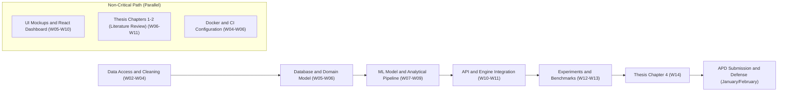

# Project Schedule and Critical Path Analysis

**Winter Semester – MIS WUT Project Team**

---

## 1. Calendar Assumptions and Defensive Schedule Strategy

- Semester duration: 15 teaching weeks.
- Final deadline for uploading the thesis to the APD system: **February 1, 2027**.
- In accordance with lecture L1 guidelines, the schedule includes a **2-week Code Freeze buffer** at week 12 to avoid cramming work into January.

---

## 2. Weekly Schedule (15 Weeks)

```
[Week 01-03] Stage 1: Requirements, MVP, Concept, Risk Register
[Week 04-05] Stage 2: C4 Architecture, API Contracts, Database Models
[Week 06-08] Stage 3: Core Implementation, Data Pipeline, Unit Tests
[Week 09-11] Stage 4: Module Integration, Alpha Version, Integration Tests in CI
[Week 12]    CODE FREEZE! Complete, working application for laboratory review
[Week 13-14] Stage 5: Final Acceptance, Benchmarks (Chapter 4), Thesis Writing
[Week 15]    Supervisor review, APD archive preparation, and screencast recording
[February]   Submission to APD and Thesis Defense before the Examination Board
```

|    Week     | Milestone / Stage         | Scope of Work                                                                        | Accountable (RACI: A) |  Risk Buffer   |
| :---------: | :------------------------ | :----------------------------------------------------------------------------------- | :-------------------: | :------------: |
| **W01–W02** | Kickoff & Concept         | Scope agreement with supervisor, team charter, RACI, repository setup                |    Alice Kowalska     |      None      |
|   **W03**   | **Stage 1 (Lab)**         | Submission of Requirements Specification, MVP, NFR, Risk Register                    |    Alice Kowalska     |     3 days     |
|   **W04**   | Technical Design          | C4 container diagram design, ERD schema, OpenAPI contracts                           |       Bob Nowak       |      None      |
|   **W05**   | **Stage 2 (Lab)**         | Submission of Architecture and Technical Design Document                             |       Bob Nowak       |     2 days     |
| **W06–W07** | Core Implementation       | Ingestion engine, database models, analytical model skeleton                         |    David Zieliński    | Midterms (W07) |
|   **W08**   | **Stage 3 (Lab)**         | Submission of Core Implementation (first working E2E trace)                          |    David Zieliński    |     4 days     |
| **W09–W10** | Integration & UI          | React frontend, API integration, CI pipeline in GitHub Actions                       |   Carol Wiśniewska    | Nov 1 Holiday  |
|   **W11**   | **Stage 4 (Lab)**         | Submission of Alpha Version and Integration Test Report                              |   Carol Wiśniewska    |     3 days     |
|   **W12**   | **FEATURE FREEZE**        | Complete freeze on new features. System 100% stable                                  |       Everyone        |  **2 weeks**   |
|   **W13**   | **Stage 5 (Lab)**         | **Final Application Acceptance** in MiNI lab, 1-page manual                          |       Everyone        |      None      |
|   **W14**   | Evaluation & Measurements | p50/p95/p99 latency measurements, vector charts for Chapter 4                        |    David Zieliński    |  Winter break  |
|   **W15**   | Thesis Finalization       | LaTeX thesis editing, AI declaration, JSA anti-plagiarism check, supervisor sign-off |    Alice Kowalska     |     5 days     |
| **January** | APD Submission            | APD package generation, thesis upload, reviews                                       |       Everyone        |  Until Feb 1   |

---

## 3. Critical Path Identification

In an analytical-software project, the critical path determines the earliest possible completion date of the project.



> [!WARNING] ⚠️ **Critical Path Note:**
> Any delays in data ingestion modules and the analytical pipeline directly delay the execution of benchmarks (Chapter 4), making timely thesis submission to APD impossible. These tasks are subject to weekly review.
